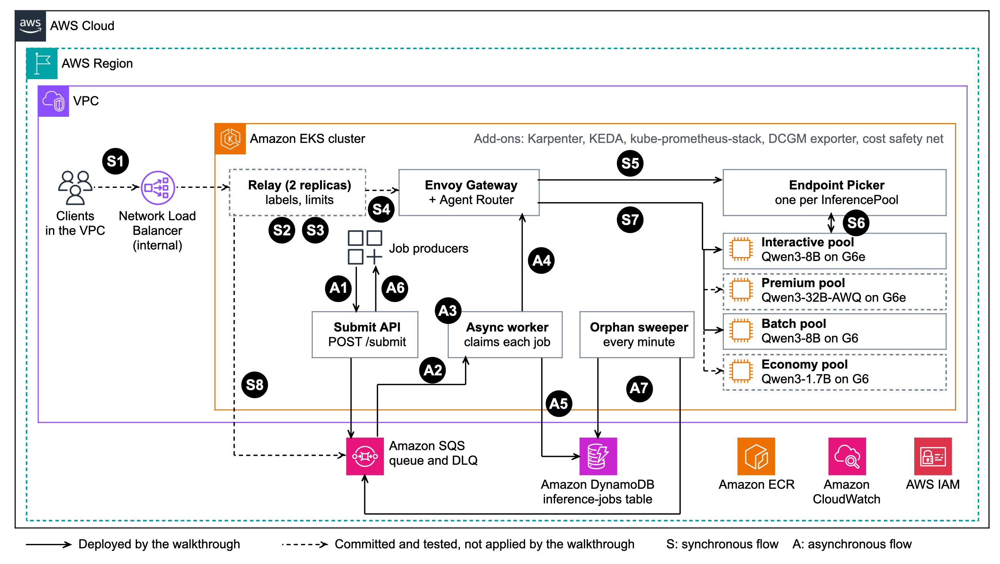

# Routing interactive and batch LLM inference on Amazon EKS with inference-aware networking

> **This is sample code, for non-production usage.** You should work with your security and legal teams to meet your organizational security, regulatory and compliance requirements before deployment.

AI agents send two kinds of large language model (LLM) requests to the same endpoint. A reply to a user needs an answer in about a second. An overnight summary can wait an hour, but it must not be lost or run twice. A load balancer sees identical HTTP calls. Batch work then slows interactive answers, every replica recomputes the same shared prompts, and long requests time out and lose their work.

This sample adds an admission layer in front of vLLM on one Amazon Elastic Kubernetes Service (Amazon EKS) cluster. A caller marks each request interactive or batch with one header. Interactive and batch traffic run on separate GPU pools. In each pool, an Endpoint Picker scores the replicas on prefix-cache affinity and on live queue and KV-cache load, and sends the request to the best one. Batch jobs wait in Amazon Simple Queue Service (Amazon SQS), and an Amazon DynamoDB claim admits each job to a GPU once while its claim holds.

## What you get

- Interactive answers stay fast during a batch flood. On a fresh Amazon EKS 1.37 cluster, interactive p95 time to first token was 66 ms while 40 batch requests ran, 20 at a time. The repository's tier-isolation test measured it from a Job inside the cluster, against a 500 ms limit.
- Cache-aware placement pays off when shared prompts outgrow GPU memory. Compared with round-robin, it raised prompt reuse from 42 to 97 percent and cut p90 time to first token by 65 percent (0.081 s against 0.231 s).
- The routing gain depends on your traffic, so measure it first. With only a few shared prompts that every replica keeps, cache-aware placement was 6.4 percent slower at p90.
- Batch jobs survive failures. When 3 of 6 worker pods were force-deleted during 300 jobs, all 300 completed, in 309 GPU runs. In an earlier series, 3,000 submissions of 1,000 distinct jobs ran 1,000 times, and none was lost.
- You can check the design before you pay for anything. `make test-offline` runs 22 targets with no cluster, no GPU and no AWS credentials.

The routing benchmark ran with four replicas per pool on an earlier stack: Amazon EKS 1.34 with Endpoint Picker v1.5.0. The current pins use the same default scorer weights, but the benchmark was not re-run on them. [docs/RESULTS.md](docs/RESULTS.md) has the methods and numbers for the routing and durability results. The Amazon EKS 1.37 figures come from a test run of the walkthrough on 2026-11-16.

The optional relay also protects long requests from timeouts. A non-streaming interactive request that has not answered after 120 seconds is abandoned and re-queued as a batch job, which generates the answer again from the start. The caller gets HTTP 202 with a job ID. The repository tests this path with a stub backend.

## How it works



The callouts follow two flows:

- Synchronous (S1 to S8). A client in the VPC calls the relay through an internal Network Load Balancer. The relay assigns two routing headers and forwards to Envoy Gateway. The Endpoint Picker of the selected `InferencePool` chooses a vLLM replica from live metrics.
- Asynchronous (A1 to A7). A job producer in the cluster posts to the submit API, which enqueues one message. The worker claims the job in DynamoDB, calls the same gateway with the batch header, and records the result. An orphan sweeper re-enqueues jobs whose claim lease expired.

The stage targets deploy the interactive and batch pools and the queue path, drawn as solid lines. You apply the sweeper yourself in step 7. The relay, its load balancer, the premium and economy pools, and promotion are committed and tested offline. No stage target applies them, so they are drawn dashed. The batch pool can run on G6e, G6 or G5 instances.

### Request headers

| Header | Values | What it selects |
|---|---|---|
| `x-gateway-inference-objective` | `interactive`, `batch` | The GPU pool |
| `x-inference-model-class` | `economy`, `standard`, `premium` | The model class. The walkthrough deploys only `standard`. |

Through the relay, a request with no urgency header is treated as batch. A request with no class header gets the cheapest class whose context window fits its prompt and output budget. Attached tools or a long conversation can raise that class. An interactive request never lands on economy. A batch or unlabeled request can, and on the walkthrough setup the gateway then returns HTTP 500, because no economy pool is deployed. So send `x-inference-model-class: standard` with every request.

The relay reports its decision in the `x-relay-sla`, `x-relay-capability` and `x-relay-reason` response headers. A streaming request is promoted only if it sends `x-accept-promotion-event: true`.

### Batch jobs

A job producer in the cluster posts to the submit API:

- `POST /submit` with `{"client_id": "...", "payload": {...}}`, where `payload` is the body of a `/v1/chat/completions` request. The answer is HTTP 202 with `{"job_id": "..."}`.
- An optional `capability` field takes `economy` or `standard`. On the walkthrough setup, leave it out or use `standard`. The submit API refuses `premium` with HTTP 400, because batch work reaches premium only by promotion.
- `GET /jobs/<job_id>` returns the job state and, once complete, the result. Until a worker claims the job, it answers HTTP 404 with status `not_found`, so keep polling.
- A job ID has the form `<client_id>#<hash>`. Encode the `#` as `%23` in the URL, or the server receives a truncated ID and answers 404.

A request that the relay promotes gets the same kind of job ID, with a `redeem` field that points to `/jobs/<job_id>` on the submit API.

## Before you start

- An AWS account with service quota for the G6e (NVIDIA L40S), G6 (NVIDIA L4) and G5 (NVIDIA A10G) instance families.
- The sample runs in us-west-2. The Region is set in the cluster definition, the Makefile and the scripts, so pass `--region us-west-2` on every `aws` command you run yourself.
- An IAM principal that can create an Amazon EKS cluster with its add-ons, IAM roles and policies, and AWS CloudFormation stacks. The walkthrough also creates Amazon SQS queues, a DynamoDB table and Amazon ECR repositories.
- kubectl, Helm, eksctl, the AWS CLI and jq on your path. The 2026-11-16 run used kubectl 1.37.2, Helm 3.19.0, eksctl 0.231.0 and AWS CLI 2.37.5.
- git, make, curl, perl, shasum and nc, which the scripts call, and [crane](https://github.com/google/go-containerregistry/tree/main/cmd/crane) for step 6.
- Python 3.11 or later with the `venv` module.
- A cost ceiling, agreed before you provision any GPU.
- No Hugging Face token. The three Qwen3 models are ungated, under Apache License 2.0.

## Deploy the walkthrough

Run every command from the repository root. The cluster is named `inference-aware-eks`.

### 1. Check the design offline (free)

```bash
git clone https://github.com/aws-samples/sample-inference-aware-networking-on-eks.git
cd sample-inference-aware-networking-on-eks
make venv
make test-offline
make preflight
```

`make test-offline` covers the cross-manifest invariants, the version pins, the request bounds and the teardown context check. It also runs mock-backed proofs of exactly-once claiming. `make preflight` checks that kubectl, Helm, eksctl, the AWS CLI, jq and the virtual environment are present, and that `versions.yaml` has no unfilled value.

### 2. Point the repository at your account

```bash
make set-account ACCOUNT_ID=<account-id>
git commit -am "Use my AWS account"
```

`make set-account` refuses a dirty working tree, so `git checkout .` undoes it. Commit the result, because `make set-worker-image` in step 6 also refuses a dirty tree.

### 3. Create the cluster

Billing starts here.

```bash
make cluster-up
make addons
make observability-crds
```

Expect an Amazon EKS 1.37 cluster with two `m6i.xlarge` system nodes and no GPU nodes. `make addons` installs Karpenter, the Amazon EKS Pod Identity Agent and KEDA. It also installs Envoy Gateway with Agent Router, the Gateway API Inference Extension and llm-d CRDs, the NVIDIA device plugin and the AWS Load Balancer Controller. It tags the private subnets and the cluster security group for Karpenter.

Keep your machine awake and online while `make cluster-up` runs, because eksctl stops if it loses its connection. If it stops after the control plane exists, finish the cluster from the same file:

```bash
eksctl create nodegroup --config-file infra/cluster/eksctl-cluster.yaml
eksctl utils update-cluster-logging --config-file infra/cluster/eksctl-cluster.yaml --approve
eksctl utils write-kubeconfig --cluster inference-aware-eks --region us-west-2
```

### 4. Arm the cost safety net

```bash
kubectl apply -f manifests/07-safety-net/safety-net.yaml
make arm-safety-net MINUTES=90
bash infra/addons/install-device-plugins.sh neuron
make preflight-bringup
```

When the deadline passes, the safety net scales every serving tier to zero and pauses KEDA. `make stage-1` and `make stage-3` arm it if it is not armed, but they do not extend it, so re-arm it before a long run. `make preflight-bringup` checks both device plugins. Install the Neuron one even though this walkthrough uses no AWS Inferentia: it adds a DaemonSet, not a node.

### 5. Deploy the interactive tier

```bash
make dry-run
make stage-1
```

Expect `validated 35, skipped 1, exempt 3, failed 0` from the dry run. `make stage-1` launches the first GPU node and deploys the interactive pool behind its Endpoint Picker. It then checks that a request reaches a replica.

### 6. Build the worker image

Create the two Amazon ECR repositories, and copy the BuildKit image that the in-cluster build uses:

```bash
aws ecr create-repository --region us-west-2 --repository-name inference-async-worker
aws ecr create-repository --region us-west-2 --repository-name inference-builder
REGISTRY=<account-id>.dkr.ecr.us-west-2.amazonaws.com
aws ecr get-login-password --region us-west-2 | crane auth login "$REGISTRY" -u AWS --password-stdin
crane copy docker.io/moby/buildkit@sha256:cd04bc0c17a68703683d100109bbc1f8389fc5bb5e2946f0d2af062d1dc83238 \
  "$REGISTRY/inference-builder:buildkit-v0.32.0-rootless"
```

That digest is the linux/amd64 image of `moby/buildkit:v0.32.0-rootless`, and the build pulls it by digest, so copy it unchanged. Then build and pin the worker image:

```bash
bash infra/addons/setup-builder.sh
GIT_SHA=$(git rev-parse origin/main) bash infra/addons/run-build.sh
make set-worker-image TAG=<the tag that run-build.sh prints>
```

`run-build.sh` builds in the cluster from a `git archive` of one commit, and it refuses a commit that no remote branch contains. Your `set-account` commit is local, so build `origin/main`. The image content does not depend on the account.

### 7. Add the queue path and the batch tier

```bash
make stage-2
kubectl apply -f manifests/06-sweeper/sweeper-cronjob.yaml
make stage-3
make observability-scalers
```

`make stage-2` creates the queue, its dead-letter queue, the job table and one IAM role per service account. It deploys the submit API and the worker, then proves that a duplicate submission runs one GPU job. `make stage-3` adds the batch pool and the full route, then runs the tier-isolation test.

Run that test from inside the Region. If the network round trip alone takes more than a fifth of the 500 ms target, the test refuses the result. From a laptop, `make stage-3` therefore exits with an error after the deployment is complete. The 66 ms result came from the test running in a Job inside the cluster.

Install the autoscalers last. `make observability-scalers` checks the scaler queries while both tiers run, and from then on KEDA owns the replica counts. For GPU metrics, you can also run `bash infra/addons/install-dcgm-exporter.sh`.

### 8. Validate

```bash
make verify-invariants
make test-cluster
make validate
```

`make test-cluster` checks that the workloads built from the worker image run your pinned tag. `make validate` runs the scaler query check, the reachability test, the idempotency test and the tier-isolation test. It includes the tier-isolation test, so run it from inside the Region as well.

## Try the relay (optional)

```bash
kubectl apply -f manifests/03-routing/chain-b-timeouts.yaml
kubectl apply -f manifests/08-relay/relay.yaml
```

The relay reads its deadlines from the first file and does not start without it. Its load balancer is internal and accepts only `192.168.0.0/16`, the VPC CIDR that eksctl creates by default. Confirm both before you send traffic. Then send a request through a port forward:

```bash
kubectl -n inference port-forward svc/inference-relay 8080:80 &
curl -s http://127.0.0.1:8080/v1/chat/completions \
  -H 'content-type: application/json' \
  -H 'x-gateway-inference-objective: interactive' \
  -H 'x-inference-model-class: standard' \
  -d '{"model": "Qwen/Qwen3-8B", "messages": [{"role": "user", "content": "Say hello."}], "max_tokens": 128}'
kill %1
```

`bash tests/validation/test_promotion_route_shape.sh` tests promotion without a GPU. While it runs, it points the relay at a stub with a 5-second deadline. It first deletes every message waiting in the `inference` queue, so run it only when no batch job is pending. It also reads the promoted messages from the queue, so pause the worker first with `kubectl -n inference annotate scaledobject async-worker autoscaling.keda.sh/paused-replicas=0`. Remove the annotation afterwards by running the same command with `autoscaling.keda.sh/paused-replicas-`.

The relay has no authentication, so delete its Service when you are done: `kubectl -n inference delete svc inference-relay`.

## Costs

Steps 1 and 2 cost nothing. From `make cluster-up` on, you pay for the Amazon EKS cluster, its system nodes, the GPU instances that Karpenter provisions and the NAT gateway. Amazon EBS volumes, CloudWatch Logs, Amazon ECR storage and the relay's load balancer, if you deploy it, add smaller amounts.

The 2026-11-16 test run used one `g6e.4xlarge` for about 57 minutes and one `g5.2xlarge` for about 38 minutes. That is 1.58 GPU instance-hours, about 3.61 USD at On-Demand prices in us-west-2. The whole run cost about 4.80 USD by estimate. An earlier run on 2026-09-26, which covered only the deployment steps, took 27.2 minutes and 0.71 GPU instance-hours.

## Security considerations

- **No authentication layer.** The relay, the gateway, and the submit API accept any request that reaches them. The relay's Network Load Balancer is internal and accepts only the VPC CIDR, and the gateway and submit API are `ClusterIP` Services. Put your organization's identity layer in front of the relay before any use beyond testing.
- **Request bounds.** The relay and the submit API accept at most 64 connections per replica, and bound each request's headers in size and time. They refuse a body over 1 MiB or malformed framing before they read the body, and they abandon a body upload that takes longer than 30 seconds. Each relay replica forwards at most 32 requests at once and answers HTTP 503 beyond that. These limits bound memory per replica, not callers: one host in the VPC can still occupy a replica's connections, so per-caller rate limits belong in your identity layer. While that lasts, readiness fails and the replica leaves rotation. Liveness is a TCP probe, so the replica is not restarted.
- **No TLS.** Traffic inside the cluster and through the load balancer is plain HTTP. To serve callers outside the VPC, first terminate TLS at the relay behind the load balancer's TCP listener and add an identity layer. Only then change the load balancer scheme.
- **Least privilege.** Each service account has its own IAM role through EKS Pod Identity, with no long-lived credentials. The workload roles name their queue, table or repository. The exceptions are `ecr:GetAuthorizationToken` on the builder role, which IAM cannot scope to a resource, and the upstream Karpenter and AWS Load Balancer Controller policies.
- **Pod hardening.** The CPU services run as a non-root user with a read-only root filesystem, no privilege escalation, no capabilities, and the default seccomp profile. The vLLM pods keep the AWS Deep Learning Container defaults, which run as root and write a model cache. The in-cluster image build runs rootless BuildKit as a non-root user, which needs privilege escalation and an unconfined seccomp profile.
- **Network isolation is optional.** `make network-policies` applies default-deny ingress policies for the `inference` namespace and the gateway data plane. It refuses to run until the Amazon VPC CNI enforces network policies, because an unenforced policy does nothing.
- **Data at rest.** Queued prompts and results are stored in Amazon SQS and DynamoDB, both encrypted at rest, and job items expire through a DynamoDB time-to-live. The gateway access log records request metadata, not bodies.
- **Models.** The sample downloads Qwen3 models from Hugging Face at pinned revisions under Apache License 2.0. Review the model licenses and your organization's model-use policy before you deploy.
- **Logging.** Amazon EKS control-plane logs (api, audit, authenticator) go to Amazon CloudWatch with 7-day retention.

## Responsible AI

- **Output is not filtered.** The sample serves self-hosted open-weight models. It routes and queues requests, but it does not filter or validate what the models return.
- **Add safeguards before users see output.** For example, the Amazon Bedrock Guardrails `ApplyGuardrail` API evaluates text from any model, including self-hosted ones, against your content policies.
- **Keep a person in the loop.** Do not use model output as the only basis for decisions that affect people. Tell users when they interact with AI.
- **Evaluate on your own data.** Test quality and bias for your use case before deployment. This sample does not measure the answer quality of capability routing.

## Limitations

- This is a proof of concept and is not production ready.
- GPU capacity is the main delivery risk. G6e returned `InsufficientInstanceCapacity` in every Availability Zone tried, repeatedly and across days. Widening the set of acceptable instance sizes helped.
- If the Endpoint Picker is down, both routing tiers fail closed and reject requests.
- A client that reaches the Envoy Gateway data plane directly skips the relay's classification and its limits. The optional NetworkPolicies admit traffic to the data plane only from the `inference` and `monitoring` namespaces.
- Deployment names still read `vllm-llama3-*` while they serve Qwen3 models, because invariant checks, dashboards and load tests select those workloads by name.

## Clean up

```bash
make cluster-down
```

`make cluster-down` first checks that your kubectl context reaches this cluster's API endpoint, and refuses otherwise. It deletes the autoscalers, scales serving to zero and releases the nodes. It then waits until the Amazon EC2 API shows no running or pending G5, G6, G6e, Inf2, P5 or Trn instance in us-west-2. That check covers the whole account, so stop other GPU instances in the Region first; after 10 minutes it refuses to continue. It then deletes every LoadBalancer Service. Last, it deletes the cluster, the Karpenter stack and the load balancer controller role. The cost safety net runs inside the cluster, so it goes with it.

Then delete what no script removes, with `--region us-west-2` on each command:

- the queues `inference` and `inference-dlq` (`aws sqs delete-queue`)
- the table `inference-jobs` (`aws dynamodb delete-table`)
- the control-plane log group `/aws/eks/inference-aware-eks/cluster` (`aws logs delete-log-group`)
- the six IAM roles `inference-async-worker`, `inference-submit-api`, `inference-relay`, `inference-sweeper`, `inference-keda-sqs-read` and `inference-builder`, each with its inline policy (`aws iam delete-role-policy`, then `aws iam delete-role`)
- the managed policy `AWSLoadBalancerControllerIAMPolicy`, if no other cluster uses it (`aws iam delete-policy`)
- the two Amazon ECR repositories (`aws ecr delete-repository --force`)

`make cluster-down` can stop because the cluster stack could not delete a subnet. The cause is an `available` network interface that the VPC CNI left behind, with the description `aws-K8S-<instance-id>`. Delete that interface and then the `eks-cluster-sg-inference-aware-eks-*` security group. Run `aws cloudformation delete-stack --stack-name eksctl-inference-aware-eks-cluster` again. The target stopped before its last step, so also delete the `Karpenter-inference-aware-eks` stack. Then detach `AWSLoadBalancerControllerIAMPolicy` from the `inference-aware-eks-alb-controller` role and delete the role.

## Repository layout

| Path | Contents |
|---|---|
| `Makefile` | Most operations, from `make venv` to `make cluster-down` |
| `versions.yaml` | The version pins. The BuildKit digest is in `infra/addons/run-build.sh`. |
| `infra/` | Cluster definition, add-on installers, and AWS resource setup scripts |
| `manifests/` | Kubernetes manifests: node pools, serving, routing, autoscaling, observability, sweeper, safety net, relay, and network policies |
| `async-worker/` | Relay, submit API, worker, sweeper, and queue exporter, with their IAM policies |
| `tests/` | Cross-manifest invariants, the offline correctness suite, and on-cluster validation |
| `loadtest/` | Load-test drivers, dashboards, and recorded results |
| `docs/` | Measurements, runbooks, and the reference architecture |
| `DESIGN.md` | Design notes, invariants, and known traps |

The companion AWS Prescriptive Guidance pattern, "Routing interactive and batch LLM inference on Amazon EKS with inference-aware networking", walks through every step with expected results and troubleshooting.

## Security

See [CONTRIBUTING](CONTRIBUTING.md#security-issue-notifications) and [SECURITY.md](SECURITY.md) for how to report a security issue.

## License

This sample is licensed under the MIT-0 License. See the [LICENSE](LICENSE) file.

The Qwen3 chat template under `manifests/02-serving/` is third-party content under the Apache License 2.0. See [THIRD-PARTY-LICENSES](THIRD-PARTY-LICENSES). It lists the Python packages that the sample installs, and points to `versions.yaml` for the images and charts.
